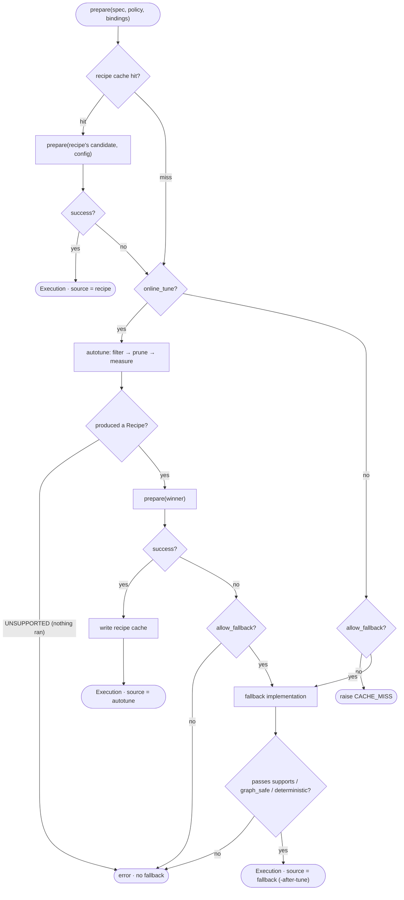

# cuda-new Design

> Architecture notes for `crates/apxinf-cuda-new`.
> Public API listing: `doc/cuda-new-api.md`;
> English contract: `crates/apxinf-cuda-new/README.md`; tunable operator catalog: `cuda-operator.md`.

## Migration status

This document defines the target architecture. The implementation is still being
converged toward it; `plan.md` is the authoritative completed/partial/remaining
checklist. In particular, `ops::fused` has been removed and model entry points now
go through `ops`, while legacy dtype/layout/shape-named L3 wrappers remain as an
explicit shrinking allowlist.

The architecture guard is intentionally CUDA-build independent:

```bash
python3 scripts/check_cuda_new_architecture.py          # CI checks
python3 scripts/check_cuda_new_architecture.py --list   # public src/ops inventory
```

It rejects new forbidden L3 names, model-layer calls into cuda-new FFI, and CUDA
kernel definitions in adapters. Passing the guard means no new layering debt was
introduced; it does not mean every existing item in `plan.md` is complete.

Contents:

1. Choosing how to add an operator (§1) — **read this first**
2. Layering (§2)
3. Tunable operators (§3)
4. Family operators (§4)
5. Fixed operators (§5)
6. Autotune and fallback (§6: Recipe vs Execution / selection–tuning–fallback decision graph / policy)
7. Graph capture and sessions (§7: why graphs / thread-local flags / session / two passes / PreparedPhase / cross-position reuse)
8. Naming conventions (§8)

---

## 1. Choosing How to Add an Operator

This section decides *which* of the three operator shapes a new operator takes.
Getting it wrong is the single most expensive mistake in this crate, because the
cost shows up later as a name that has to be multiplied rather than a field that
can be added.

### 1.1 "Many variants" means two different things

| | Example | What varies | What it needs |
|---|---|---|---|
| **One semantic, many implementations** | `gemm` | cuBLAS / cuBLASLt / CUTLASS, dozens of tile configurations. Which is fastest is **not knowable without measuring**. | Candidate registry + autotune + persisted recipe (§3) |
| **Many semantics, one implementation** | the norm family | `rms_norm` vs `rms_norm + residual` are **different math** with different results; each has exactly one sensible kernel. Nothing to select. | Spec fields, no selection machinery (§4) |

These are orthogonal axes. GEMM and Attention have *both*: multiple competing
implementations **and** a family of fused epilogue semantics. The norm family has
only the second. An operator with neither is a fixed operator (§5).

The failure mode is treating the second axis like the first: giving every
combination of the same underlying stages its own name. That multiplies. See §8.3
for the signals that it is already happening.

### 1.2 Five questions, in order

```text
1. Are there multiple implementations whose relative speed requires measurement?
     yes → tunable operator (§3): candidate registry + autotune + recipe
     no  → skip the selection machinery; with one implementation the registry,
           recipes, and tuning all degenerate to picking 1 out of 1

2. Does it hold state across calls (handles, pre-packed weights, workspace)?
     yes → prepare/enqueue/destroy triple + ExecutionSession (§7.3)
     no  → single-shot launch

3. Does it belong to the same mathematical family as an existing operator?
     yes → add it to that family. DO NOT open a new file. (§1.3)
     no  → new family: see §1.4 for which shape

4. Does its output need to be quantized, because the consumer is a quantized
   GEMM, an FP8 KV cache, or an e4m3 attention kernel?
     yes → quantization is a FIELD on the Spec, not a new `*_quantize` name (§4.3)
     no  → no epilogue axis

5. Is there fusion BEFORE the main computation (before the reduction)?
     yes → the presence/absence of the prologue picks the FUNCTION, because it
           changes the signature shape — the number of outputs and their in-out
           semantics. Details *inside* the prologue stay fields. (§4.2)
     no  → one entry point
```

Question 3 is the one most often skipped, and skipping it is how a file named
after a model instead of after a mathematical family gets created.

### 1.3 Organize by mathematical semantic, never by model

Files under `src/ops/` are named after **what the operator computes**, never after
which model or which block of a model happens to call it.

```text
GOOD   norm/   rope/   gather/   pointwise/   quantization/   gemm/   attention/   sampling.rs
BAD    mlp.rs  attn_ops.rs  model.rs       ← named after a call site
```

A file named after a call site becomes a junk drawer: the next model's RMSNorm
lands in it instead of in the norm family, and the same mathematical semantic ends
up implemented twice. That is not a hypothetical — `ops::mlp::rms_norm` and
`ops::rms_norm` coexisted for exactly this reason until they were merged, while
the former `gdn_widen_f16_to_bf16` duplicate has since been removed in favor of
`QuantizationSemantic::CastF16ToBf16`.

The three names on the BAD line are kept as the worked example, not as a
description of the tree: they held twelve operators from seven families and have
since been emptied into those families (§5.2). Two things that cost are worth
noting from it. The drawers reproduced themselves one layer down — each had a
matching `adapters/elementwise/`, `adapters/attn_helpers/` or
`adapters/reduction/`, named after an implementation technique rather than a
family — so clearing three Rust files meant clearing six directories. And four
of the twelve operators turned out to sit one field away from an existing Spec
semantic without being mergeable into it; that list only became visible once the
files were in the right place.

Two organizing axes cannot both be used. When "by semantic" and "by model" are
mixed, the same operator necessarily appears in both, and nothing in the build
catches it.

If a model needs a variant of an existing semantic, the variant is a field in that
family's Spec. If it needs genuinely new math, it is a new semantic **in the family
that owns that math**.

### 1.4 The three shapes

| Shape | When | ABI | Where |
|---|---|---|---|
| **Tunable** | measurement is required to choose an implementation | one `prepare`/`enqueue`/`destroy` triple per family | §3 |
| **Family** (Spec-dispatched) | several related semantics, one implementation each, shared validation | one `launch(runtime, spec, bindings)` per family, Spec carries a `version` | §4 |
| **Fixed** | a single isolated operator with no variants | flat parameters, one extern per operator | §5 |

Default to **fixed** for a brand-new isolated operator — a Spec for something that
will never gain a variant is pure overhead. Promote to **family** when the variants
arrive; §5.1 gives the threshold.

---

## 2. Layering: L3 → L0

```text
L3  Semantic layer (Rust)   src/ops/<op>.rs             defines WHAT to compute
L2  Execution layer (Rust)  src/ops/<family>/contracts.rs,   validation, normalization, cache keys
                            src/ops/<family>/*execution*.rs
────────────── C ABI (src/ffi/abi/*.rs ↔ native/include/apxinf_cuda/*.h) ──────────────
L1  Native operator (C++)   native/adapters/<family>/   selection, tuning, fallback
L0  Kernel layer (CUDA)     native/kernels/             device-side computation
```

### The L3 interface exposed to the model layer

`src/ops/gemm/contracts.rs`, `src/ops/attention/contracts.rs`:

```rust
pub struct GemmArgs<'a> {
    pub a: &'a Tensor,
    pub b: &'a Tensor,
    pub out: &'a mut Tensor,              // canonical row-major [M, N]
    pub quantization: GemmQuantization<'a>,
    pub alpha: f32,
    pub output_scale: f32,
    pub policy: GemmPolicy,
}
pub fn gemm(ctx: &CudaContext, args: GemmArgs<'_>) -> Result<()>

pub struct AttentionArgs<'a> {
    pub query: &'a Tensor,
    pub key: &'a Tensor,
    pub value: &'a Tensor,
    pub out: &'a mut Tensor,
    pub mask: AttentionMask,              // None / Causal
    pub scale: f32,
    pub output_scale: f32,
    pub policy: AttentionPolicy,
}
pub fn attention(ctx: &CudaContext, args: AttentionArgs<'_>) -> Result<()>
```

The L3 interface only describes *what* to compute: the parameters are tensors, a mask,
scaling factors, and a policy. No backend library name (cuBLAS / CUTLASS / FA2) appears
in the signature. The policy expresses constraints only — whether on-line tuning is
allowed, whether graph capture must be possible, whether bitwise reproducibility is
required — never which implementation to use; that choice belongs to L1. `GemmPolicy`
and `AttentionPolicy` share the same fields; defaults are in §6.3.

### L3 → L2

One line each; normalize, then enter the execution layer:

```rust
// src/ops/gemm/gemm.rs
pub fn gemm(ctx: &CudaContext, args: GemmArgs<'_>) -> Result<()> {
    execution::execute(ctx, normalize(ctx, args, Semantic::Gemm, None)?)
}

// src/ops/attention/attention.rs
pub fn attention(ctx: &CudaContext, args: AttentionArgs<'_>) -> Result<()> {
    execution::execute(ctx, normalize(ctx, args)?)
}
```

The L2 of both families follows the same flow, just in different files: compute an
`ExecutionKey` from the normalized result, look it up in the per-process session cache
(`lookup_execution`); on a hit reuse the prepared handle, on a miss build a new one and
store it back (`store_execution`). GEMM lives in `gemm_execution.rs`, Attention in
`attention/execution.rs`.

### L2 → L1: the C ABI

Each tunable operator family exposes exactly one prepare/enqueue/destroy triple; the
semantics within a family are distinguished by the Spec's `semantic` field rather than
by separate interfaces. Responsibilities:

- `prepare`: outside capture, performs selection, tuning, and resource allocation, and
  returns an opaque handle (`execution`). The handle is bound to the current addresses
  and stream and can be enqueued repeatedly.
- `enqueue`: only submits already-prepared work to the stream; never selects, allocates,
  or synchronizes. During capture this is the only call allowed.
- `destroy`: releases the provider state and resources owned by the handle.

All parameters are plain data (runtime / spec / policy / bindings); the handle itself is
opaque to Rust:

```rust
// src/ffi/abi/gemm.rs ↔ native/include/apxinf_cuda/gemm.h
fn apxinf_gemm_prepare(runtime, spec, policy, bindings, execution) -> i32;
fn apxinf_gemm_enqueue(execution) -> i32;
fn apxinf_gemm_destroy(execution);

// src/ffi/abi/attention.rs ↔ native/include/apxinf_cuda/attention.h
fn apxinf_attention_prepare(runtime, spec, policy, bindings, execution) -> i32;
fn apxinf_attention_enqueue(execution) -> i32;
fn apxinf_attention_destroy(execution);
```

### L1 → L0

After L1 selects a candidate, it calls the candidate's `launch_*` callback (a host-side
function). Three kinds of L0 backends:

| L0 kind | What the launch callback does | Examples |
|---|---|---|
| Hand-written kernel | Launches a `__global__` from `native/kernels/custom/` directly with `<<<grid, block>>>` | `launch_custom` → `attention_scores_softmax` |
| CUTLASS / FA2 template instance | Calls a host wrapper in `native/kernels/cutlass\|fa2/` which launches the template kernel internally | `launch_cutlass_nvfp4`, `launch_fa2` |
| Vendor library | Calls the cuBLAS / cuBLASLt API; the library launches the kernel | `launch_cublas`, `launch_cublaslt` |

All three enqueue asynchronously on the current stream, so all three are recordable by
the graph capture of §7.

---

## 3. Tunable Operators (the GEMM and Attention Families)

Multiple implementations are registered for the same semantic and selected by shape,
precision, and hardware.

### Semantics and candidates (`native/adapters/*/candidates.cpp`)

GEMM family — 6 semantics, each an independent tuning domain:

| Semantic | Candidates | Fallback |
|---|---|---|
| `gemm` | `cublas+custom-epilogue`, `cublasLt+custom-epilogue` (8 configs), `cublasLt-native-fp8+custom-epilogue`, `cublasLt-native-nvfp4`, `cutlass-fp8`, `cutlass-nvfp4-blockscaled` (multiple tactics) | cublas |
| `gemm_bias` | `cublas+custom-epilogue`, `cublasLt+custom-epilogue` | cublas |
| `gemm_bias_gelu` | `cublas+custom-epilogue`, `cublasLt+custom-epilogue` | cublas |
| `gemm_bias_residual` | `cublas+custom-epilogue`, `cublasLt+custom-epilogue` | cublas |
| `gemm_geglu` | `cublas+custom-epilogue`, `cublasLt+custom-epilogue`, `cutlass-dual-geglu`, `cutlass-bf16-dual-geglu` | cublas |
| `gemm_swiglu` | `cublas+rounded-swiglu`, `cublasLt+rounded-swiglu`, fixed SM110 CUTLASS when compiled | cublas |

Attention family — 3 tuned semantics, each an independent tuning domain:

| Semantic | Candidates | Fallback |
|---|---|---|
| `attention` (dense) | `cutlass-fmha-sm100`, `flash-attention-2`, `flash-attention-2-f16-e4m3-522`, `custom-attention-fallback` | custom |
| `kv_cache_attention` | `flash-attention-2-kv-cache`, `custom-kv-cache-attention` | custom |
| `segmented_attention` | `custom-segmented-attention` | custom |

Packed QKV is part of the dense `attention` semantic. `AttentionInput::PackedQkv`
describes the storage layout and static Q/K/V offsets; normalization produces the
same dense semantic and tuning key as separate Q/K/V tensors. Providers decide
support from the layout binding, so packed FA2 shares the dense candidate registry
and recipe domain rather than maintaining a fourth semantic.

Not every candidate is compiled into every binary: CUTLASS / FA2 candidates are only
registered when the corresponding build target is enabled (e.g.
`#ifdef APXINF_GEMM_CUTLASS`), so in some builds they simply do not exist in the table.
Every candidate carries capability bits (`required_device_features`) describing the
hardware features it needs; selection compares them against the current device's SM.
Registry construction asserts that each semantic has exactly one fallback.

> **Note — the epilogue axis applies here too, and is not yet factored out.**
> The six GEMM semantics differ only in their epilogue: add bias, then GELU, then
> a residual, or split `B` in half for GeGLU. The `A@B` body is identical. By §1.1
> that is the *second* axis, so by §4.3 it should be a field rather than five
> names — and the cost of not doing so is visible in `candidates.cpp`, where the
> first two candidates are registered verbatim in all five tables, with the source
> itself noting that they "happen to be the same vendor implementations".
>
> It is nonetheless left as-is deliberately. Unlike the norm family, a GEMM
> epilogue participates in candidate `supports()` predicates and in the tuning key,
> so collapsing the semantics is not a pure L3/L2 change. If it is done, the
> vendored CUTLASS Epilogue Visitor Tree is the mechanism to use rather than a
> hand-rolled field set. Until then, GEMM and Attention follow §3 as written; the
> rules of §1 are not retroactive to them.


### Execution chain

L2 `src/ops/gemm/gemm_execution.rs` + L1 `native/adapters/gemm/execution.cpp`
(attention is structured identically). A call first consults the per-process
`ExecutionKey` cache; a hit enqueues directly, and only a miss crosses the C ABI into
L1 for selection/tuning/fallback:

```text
fn execute(ctx, spec, bindings):
    exec_key = ExecutionKey(spec, bindings)     # includes addresses/stream/scalars; this process only
    if exec := session_cache.get(exec_key):
        return exec.enqueue()                   # hit: handle is ready, just enqueue
    ── miss: cross the C ABI into L1 (prepare) ──
    recipe_key = RecipeKey(spec, device)        # no pointers; persistable, cross-process
    if recipe := recipe_db.lookup(recipe_key):
        exec = recipe.candidate.prepare(spec, bindings)
    elif policy.online_tune:
        recipe = autotune(candidates, spec)     # §6
        recipe_db.store(recipe_key, recipe)
        exec = recipe.candidate.prepare(spec, bindings)
    elif policy.allow_fallback:
        exec = fallback(spec, bindings)         # §6
    else:
        raise CACHE_MISS
    session_cache.put(exec_key, exec)
    return exec.enqueue()
```

The two keys differ: an `ExecutionKey` includes the current addresses and stream and is
only valid in this process's session cache; a `RecipeKey` contains only the problem
description and device, so it can be persisted to disk and reused across processes
(the same shape with a different set of pointers still maps to the same recipe).

Core objects:

| Object | Contents |
|---|---|
| Candidate | provider id + implementation id/version + capability bits + prepare/launch callbacks |
| Recipe | candidate identity + configuration number; pure identity, persistable, no pointers |
| Prepared Execution | instantiated from a recipe; enqueueable repeatedly; valid only in this process |
| Spec / Policy / Bindings | plain data across the ABI: problem description / constraints / current pointers |

---

## 4. Family Operators (Spec-dispatched, one implementation per semantic)

Several related semantics, each with exactly one kernel, sharing one ABI entry point
and one validation path. No registry, no autotune, no recipe — per §1.2 question 1
there is nothing to measure.

```text
# src/ops/norm/ → src/ffi/abi/norm.rs → native/adapters/norm.cu → kernels/custom/norm.cuh
fn norm(ctx, NormArgs):
    execute(ctx, normalize(ctx, args)?)      # fills Spec fields
    → apxinf_norm_launch(runtime, spec, bindings)
      → validate_spec / validate_bindings    # C++ re-validates, does not trust Rust
      → dispatch on Spec FIELDS to a kernel
```

Current families: `norm/`, `pointwise/`, `quantization/`, `rope/`, `gather/`.

What distinguishes this shape from a fixed operator (§5) is that **adding a variant
adds a field, not a function**. Three properties follow, and they are the whole
reason the shape exists:

- `Spec` carries an explicit `version`; the C++ side rejects a mismatch outright.
  So the struct can evolve. Flat-parameter ABIs cannot — changing a signature
  breaks every caller, so the only available move is adding another function.
- Changing the Spec forces every caller to recompile, so a missed call site is a
  **compile error** rather than a silently stale path.
- Validation is written once per family instead of once per entry point, so
  "function A checks the dtype, function B forgot" cannot happen.

Both sides validate independently. C++ does not trust the Rust layer: the adapter
re-derives every binding predicate from the Spec field that decides it.

### 4.1 Deriving predicates from fields, not from a semantic table

The anti-pattern this replaced: nine semantic codes, each decoded through parallel
hand-written predicate tables (`reads_weight`, `writes_hidden`, …) in *both* Rust
and C++, which had to be kept in step by hand — and whose divergence produced no
error anywhere.

Each predicate must be derived from the single field that decides it:

```text
reads_weight     ⟸ affine_kind ∈ {weight, weighted_adaptive}
reads_norm_style ⟸ affine_kind ∈ {adaptive, weighted_adaptive}
reads_norm_bias  ⟸ norm_kind == layer
writes_hidden    ⟸ operation != norm             # fused_add_norm *and* residual_add
reads_residual   ⟸ operation != norm
quantizes_output ⟸ quant_kind != none
```

Note what the first two lines are not: `affine_kind != none` would make the
adaptive forms demand a `weight` binding they do not take, and
`operation == fused_add_norm` would null the only output `residual_add` has.
Each predicate reads the field that decides it and no coarser test.

One field decides one predicate, on both sides, so the two sides cannot drift.
A combination with no kernel must raise `APXINF_STATUS_UNSUPPORTED` **naming the
offending field values** — never fall through to an arithmetically different
neighbour.

### 4.2 Staged operators: prologue / core / affine / epilogue

The norm family is the only family with fusion on both sides of its reduction, and
it is worth stating the model explicitly because the two sides are expressed
differently.

```text
prologue   add bias? add residual? gate? rounding order?   ← feeds INTO the reduction
core       no statistic / RMS / mean-variance
affine     weight / weight+1 / adaptive scale-shift
epilogue   nothing / quantize to FP8 / quantize to NVFP4    ← consumes the result
```

**The epilogue is a field. The prologue picks the function.**

The asymmetry is not a style choice. An epilogue is "compute, then append a stage" —
the result is already in registers, so any epilogue can be bolted on without
changing the signature; a nullable output pointer suffices. CUTLASS expresses this
as a composable Epilogue Visitor Tree, and every mature engine parameterizes it.

A prologue changes the **signature shape**: with a residual there are two outputs
(the pre-norm sum, which the residual stream still needs, and the normalized
tensor); without one there is a single output. Expressing that as `Option` would
create parameters that are mandatory in some configurations and forbidden in
others. No engine solves this — vLLM, FlashInfer, and ONNX Runtime all split on the
function/op name (`rms_norm` vs `fused_add_rms_norm`; `LayerNormalization` vs
`SkipLayerNormalization`) and keep only the prologue's *details* as parameters.

So the norm family is three entry points, not nine:

| Entry point | Outputs | Covers |
|---|---|---|
| `norm` | 1 | plain RMS / LayerNorm / adaptive, any affine, any epilogue — except `Affine::Weight { offset: true }`, whose single kernel is BF16-in/BF16-out and unquantized |
| `fused_add_norm` | 2 (hidden + normalized) | the same, with a residual prologue |
| `residual_add` | 1 | prologue only, no normalization |

and the axes inside them are fields: `NormKind`, `Affine` (including
weight-offset and weighted-adaptive forms), `Option<QuantOut>`, `Option<bias>`,
`Option<ResidualGate>`, `NormNumerics`, and `BiasOrder`.

The common native Norm Spec is currently version 6. Planning-compatible
weighted-adaptive and unit-offset-gate paths already share the formal L3
entries, but still use preserved private launch ABIs internally. Consolidating
those private launchers into the one family ABI is a cleanup/merge gate; it is
not a reason to reintroduce public specialized names.

`BiasOrder` deserves a note: `bias → round → residual` and `bias → residual → round`
differ only in an intermediate BF16 rounding. That is not an implementation detail
here — this engine reproduces reference implementations bit-for-bit, so a rounding
order is part of the contract. It is still a *field*, not a semantic.

### 4.3 Quantization epilogues belong to a shared policy

Per §1.2 question 4, an operator whose output feeds a quantized GEMM, an FP8 KV
cache, or an e4m3 attention kernel needs a quantization epilogue — quantization is
otherwise a full extra pass over the tensor.

By that test the operators that need one are: `norm`, `pointwise` (swiglu/geglu),
GDN's gated norm, and `apply_output_gate`. Operators whose output does not feed a
quantized consumer — `gather`, `rope` (while the KV cache stays BF16), `argmax`,
the cache operators — must **not** grow one speculatively.

The epilogue must come from one shared policy rather than being reimplemented per
family. Implementing it per family is what produced the current state: the same
"saturate and cast to FP8/NVFP4" logic exists independently in `norm.cuh`, in
`gemm_nvfp4_sm100.cu`, and in `gdn_ops.cu`. The visible symptom of that duplication
is missing combinations — the norm family's e4m3 output supports only F16 inputs,
and `pointwise`'s only its `Geglu` semantic, because each copy was written for one
caller.

### 4.4 Which axes are compile-time

Default a new axis to **runtime** (a nullable pointer, one branch). Promote it to
compile-time (a type parameter or `const` generic) only when one of the following
holds:

| Reason | Example |
|---|---|
| it changes the numerical result | RMS vs mean-variance statistic |
| it changes vectorization width or memory layout | input dtype, quantized output dtype |
| it changes the epilogue's access pattern | adaptive affine reads an extra tensor |
| measurement shows the branch costs | — use the existing benchmarks, do not guess |

`bias` presence is runtime by this rule: norm is memory-bound, so a null-pointer
test costs nothing against the memory traffic. `gate` and `BiasOrder` are the
weaker case, and worth stating honestly — the adapter does select a different
`__global__` for each of them (`bias_residual` / `bias_then_residual` /
`ada_gate_residual`), because both are *prologue* stages, which by §4.2 may change
the signature shape. They stay Spec **fields** rather than semantics all the same,
so a third rounding order adds a field value and not an entry point. What the rule
forbids is promoting them to template parameters *on top of* that dispatch, which
would multiply those three instantiations by the dtype and quantization axes with
nothing measured to justify it.

Prune illegal combinations with a static assertion rather than letting the
cartesian product exist:

```cpp
static_assert(!ADA_AFFINE || !HAS_WEIGHT, "adaptive scale/shift replaces weight");
```

### 4.5 The AOT instantiation list should be derived, not written

The combination space is bounded not by the cartesian product but by **the
combinations the shipped models actually use**. These semantic codes are internal,
not a published contract, so the set can be recomputed at any time — which is
precisely what keeps this shape from degenerating into an append-only operator
registry that can never be pruned.

Build-time instantiation should therefore be derived from the model configurations
being shipped, not hand-maintained. Today it is not: `crates/apxinf-cuda/aot/qwen38.json`
is a hand-written list. That is the gap this section names, not a description of
current state.

---

## 5. Fixed Operators

A single isolated operator with no variants. It skips L2 selection but still
crosses the L1 C ABI (parameter validation, then a direct call to the host launch
function):

```text
# src/ops/gdn.rs → src/ffi/abi/gdn.rs → native/adapters/gdn/execution.cpp → gdn_ops.cu
fn gdn_prefill(ctx, q, k, v, state, ...):
    check_shapes(...)
    abi::apxinf_gdn_prefill(...)
```

This is the right shape for a genuinely isolated operator — `argmax` is the clean
example. A Spec for something that will never gain a variant is overhead, and one
more structure for a reader to load. (`concat_rows` and `reserve_prefix` are
isolated too but do not cross the C ABI at all; see §5.4.)

### 5.1 When a fixed operator must be promoted to a family

> **When the same mathematical semantic acquires its third signature variant, it
> must be merged into a Spec-dispatched family (§4).**

- first variant: normal
- second: possibly temporary (a one-off F16 version); tolerated
- third: confirms the difference is an **axis**, not a special case — continuing to
  add functions is hand-expanding a cartesian product

The threshold is deliberately countable, so the decision needs no judgement and no
prediction about whether the operator "will" grow. Suffixes like `_seq`, `_f16`,
`_v2`, `_interleaved` on an existing semantic are the signal.

Promotion is mechanical and **does not change numerics**: N extern functions become
one `launch(spec, bindings)`, N scattered validations become one `validate_spec`,
call sites change signature, and **no kernel is touched**. The kernel count and the
arithmetic are unaffected — this shape question only concerns L3/L2/ABI/L1.

The GDN family is past this threshold. Its gated norm formerly exposed
`gdn_gated_norm` / `_seq` / `_seq_f16` / `_quantize`; the Rust L3 surface now
uses one `gdn_gated_norm(GdnGatedNormArgs)` entry whose tensor rank, input dtype,
optional quantized output, and `GdnGate::{Dense, Strided}` carry those axes.
Decay/beta preparation similarly
uses one `gdn_decay_and_beta(GdnDecayAndBetaArgs)` entry and infers step versus
sequence from rank. Chunk scan uses one `gdn_chunk_scan(GdnChunkScanArgs)` entry;
`GdnChunkScanInput` carries split versus interleaved layout while geometry is
inferred from tensors. All formal GDN semantics cross one versioned
`apxinf_gdn_launch(runtime, spec, bindings)` family ABI; native dispatch still calls
the preserved kernels with the same arithmetic and parameter order.

### 5.2 Catalog (L3 ↔ L1)

| L3 (`src/ops/`) | L1 ABI | Description |
|---|---|---|
| **gdn.rs** (↔ `abi/gdn.rs` ↔ `kernels/custom/gdn_ops.cu`) | | GDN linear attention — past the §5.1 threshold |
| `gdn_recurrent_step` | `apxinf_gdn_launch` | single-step decode recurrence |
| `gdn_gated_norm(GdnGatedNormArgs)` | `apxinf_gdn_launch` | gated RMSNorm; rank, input dtype, dense/strided gate layout and optional quantized output are contract fields |
| `gdn_causal_conv_step` / `_forward` | `apxinf_gdn_launch` | causal convolution |
| `gdn_decay_and_beta(GdnDecayAndBetaArgs)` | `apxinf_gdn_launch` | decay coefficients; rank selects step or sequence |
| `gdn_l2_normalize_heads` | `apxinf_gdn_launch` | per-head L2 normalization of q/k |
| `gdn_chunk_scan(GdnChunkScanArgs)` | `apxinf_gdn_launch` | chunked scan; split/interleaved input is a layout binding |
| `gdn_prefill` | `apxinf_gdn_launch` | batched prefill scan |
| `gdn_prepare_prefill` / `gdn_conv_prepare` | `apxinf_gdn_launch` | prefill input reordering |
| `quantization::cast` | `apxinf_quantization_launch` | F16 → BF16, BF16 → F32, or F32 → BF16 inferred from tensors |
| **rope/** (↔ `abi/rope.rs` ↔ `adapters/rope/`) | | |
| `partial_rope` | `apxinf_rope_partial` | in-place partial rotary embedding; the Spec semantics fuse a QKV split and write three outputs, this rotates one tensor |
| `execute_batched` / `execute_mrope` / `apply_vision_2d` / `apply_half_split` | `apxinf_rope_launch` | standalone rotary embedding; dtype, position source, section layout and convention are Spec fields; preserved CUDA kernels remain private dispatch targets |
| `rotary_dim` | — | host helper (§5.3) |
| **norm/** (↔ `abi/norm.rs` ↔ `adapters/norm/`) | | |
| `norm(NormArgs::with_weight_offset())` | `apxinf_norm_launch` | `(1 + weight)` RMSNorm; an aliased input/output binding selects the preserved q/k head kernel behind the family dispatch |
| **attention/gates.rs** (↔ `abi/attention.rs` ↔ `kernels/custom/attention_gates.cu`) | | |
| `split_query_and_gate` | `apxinf_attention_gate_launch` | q_proj output split; projection geometry is carried by the versioned gate Spec |
| `apply_output_gate(OutputGateArgs)` | `apxinf_attention_gate_launch` | sigmoid output gate; dense/projection source and rounding policy are gate Spec fields; preserved kernels remain private dispatch targets |
| **rope/qkv.rs** (↔ private `abi/rope.rs` launchers ↔ `adapters/rope/qkv_bf16.cu`) | | |
| `split_qkv_cache(QkvCacheRopeArgs)` | `apxinf_rope_split_qkv_cache_bf16` | packed Q/G/K/V projection split, Q/K norm, partial RoPE and token-major cache write |
| `split_grouped_qkv(GroupedQkvRopeArgs)` | `apxinf_rope_split_grouped_qkv_bf16` | group-major Q/G/K/V split, Q/K norm and partial RoPE |
| **attention/kv_cache_attention.rs** | | |
| `decode_attention` | `apxinf_decode_attention` | single-token decode, allocation-free |
| **pointwise/elementwise.rs** (↔ `abi/pointwise.rs` ↔ `kernels/custom/pointwise_ops.cu`) | | |
| `swiglu` | `apxinf_pointwise_swiglu` | SwiGLU; the SiLU-gated form, not `PointwiseSemantic::Geglu` |
| `add_into` | `apxinf_pointwise_add_into` | residual accumulation |
| **quantization/per_tensor.rs** (↔ `abi/quantization.rs` ↔ `kernels/custom/quantization_ops.cu`) | | |
| `quantize_fp8_per_tensor` | `apxinf_quantization_fp8_per_tensor` | per-tensor FP8; finite-domain arithmetic matches the independent RNE/SATFINITE oracle in scalar/vector/native-pair/tail modes, while NaN/Inf behavior differs from `FixedScaleE4m3`, so it remains a separate semantic |
| **gemm/gemv.rs** (↔ `abi/gemm.rs` ↔ `kernels/custom/gemv.cu`) | | |
| `gemv(GemvArgs)` | private `apxinf_gemm_*_gemv` launchers | M=1 projection; optional block-scale binding selects the preserved direct implementation, so no registry |
| **gather/embedding.rs** (↔ `abi/gather.rs` ↔ `kernels/custom/gather_embedding.cu`) | | |
| `embedding_gather` | `apxinf_gather_embedding` | plain BF16 row gather; **not** `GatherSemantic::EmbeddingLookup`, which always applies Gemma's `sqrt(cols)` scale and indexes with `u32` |
| **sampling.rs** (↔ `abi/sampling.rs` ↔ `kernels/custom/sampling_argmax.cu`) | | |
| `argmax` | `apxinf_sampling_argmax` | greedy selection; correctly fixed — no variants expected |
| **crate-root `sampling.rs`** (↔ `raw/sampling.rs` ↔ `kernels/custom/sampling.cuh`) | | stateful samplers: workspace + device RNG |
| `create_token_sampler` / `create_normal_generator` | `apxinf_sampling_sample_token` etc. | return `cudaError_t`, so they are declared through `raw/` rather than `abi/` — that split is the error convention, not an inconsistency |
| **quantization/block.rs** (↔ private `gemm/nvfp4_scales.rs` ↔ `abi/gemm.rs` ↔ `kernels/cutlass/ops/gemm/gemm_nvfp4_sm100.cu`) | | |
| `block_quantize(BlockQuantizationArgs)` | private `apxinf_gemm_nvfp4_quantize_*` launchers | packed block quantization; activation, RMSNorm and SwiGLU producers are semantic variants, while the concrete format comes from tensors |
| `pack_block_scales(PackBlockScalesArgs)` | `apxinf_gemm_nvfp4_pack_block_scales` | checkpoint-to-candidate block-scale layout conversion |
| `gemm_swiglu(GemmSwiGluArgs::BlockQuantized)` | `apxinf_gemm_nvfp4_dense_swiglu_aot` | fixed fused FC1 implementation selected behind the existing GEMM semantic entry point; build method and shape stay private |

The entries annotated "past the §5.1 threshold" are recorded debt, not precedent.
New operators follow §1.3 and §5.1.

The three call-site-named files this catalog used to list — `mlp.rs`,
`attn_ops.rs`, `model.rs`, with their `adapters/elementwise/`,
`adapters/attn_helpers/` and `adapters/reduction/` counterparts — are gone. Their
twelve operators moved to the families above with no change to any signature,
kernel or public name. What the move surfaced is worth keeping, because in each
case the operator looked mergeable into an existing Spec and was not:

| Looks like | Why it is not |
|---|---|
| `quantize_fp8_per_tensor` = `FixedScaleE4m3` | exhaustive finite BF16 coverage proves scalar/vector/native-pair/tail parity, but all-NaN/Inf coverage still finds 254/256 differing codes (12/13 in the tail fixture); this is a real non-finite-value contract, not just vectorization |
| `embedding_gather` = `EmbeddingLookup` | that semantic always multiplies by `sqrt(cols)`; dropping or adding the scale silently changes every embedding. Index dtype and out-of-range behaviour differ too |
| `head_rms_norm` = `AFFINE_WEIGHT_OFFSET` | resolved: q/k callers expose a rank-2 `[rows, head_dim]` view and use `rms_norm_weight_offset` with aliased input/output; 128/256-wide fixtures are bit-identical to the out-of-place family path, while the original in-place kernel remains an internal candidate |
| `swiglu` = `PointwiseSemantic::Geglu` | identical shapes and `PointwiseActivation::Silu` already exists, but `geglu` hard-codes `gelu_tanh` instead of calling `apply_activation` |

Each of these is a field away from being real, and each needs a numerics gate
rather than a rename. Moving the files first is what made them visible as a
list.

### 5.3 Host helpers (called by the model, no GPU work)

| Function | Location | Purpose |
|---|---|---|
| `rotary_dim(head_dim, factor)` | `rope/partial.rs` | rotary width, pure arithmetic |
| `gdn_state_elements(v_heads, v_dim, k_dim)` | `gdn.rs` | state element count, pure arithmetic |
| `gdn_prefill_workspace_bytes(v_heads, num_seqs)` | `gdn.rs` | prefill scratch bytes |
| `decode_attention_workspace_bytes()` | `kv_cache_attention.rs` | decode workspace bytes |
| `block_scale_buffer_bytes(rows, k, block)` | `quantization/block.rs` | block-scale buffer bytes |

Workspace queries cross the ABI to read L1 constants; they launch no kernels.

### 5.4 Data-movement operators

`concat_rows` and `reserve_prefix` (`src/ops/cache.rs`) are a fourth, smaller case:
pure stream-ordered data movement with no kernel at all, issued from Rust via
`cudaMemcpyAsync` / `cudaMemsetAsync`. They do not cross the C ABI because there is
no L1 decision to make and no L0 to call. They are still graph-safe: under a
session arena the addresses are fixed and nothing is allocated during capture.

Creating a C ABI entry point for a memcpy buys nothing. This case needs no
promotion path.

---

## 6. Autotune and Fallback

### 6.1 Two objects to keep apart: Recipe and Execution

| Object | What it is | Contains addresses? | Where it lives |
|---|---|---|---|
| **Recipe** | The chosen "candidate identity + configuration number", e.g. `(cublasLt, impl 2, config 5)` | No, pure identity | Persistable, cross-process (key = `RecipeKey`) |
| **Execution** | A runnable handle instantiated from a Recipe, bound to the current addresses and stream | Yes | This process only (key = `ExecutionKey`, see §3) |

**Tuning produces a Recipe.** `autotune` takes "a problem + a candidate table" and
outputs a Recipe (who won); it knows nothing about addresses. Turning a Recipe into a
runnable Execution is done *afterwards* by
`prepare(candidate, config, spec, bindings)`. The two caches each store one kind:
the session cache stores Executions (keys contain pointers), the recipe cache stores
Recipes (keys do not). So the order is always: **tune to get a Recipe, then prepare it
into an Execution**.

### 6.2 From prepare to an Execution: selection / tuning / fallback

`prepare`'s job is to produce an Execution (§6.1). The whole path — recipe lookup,
measured tuning, fallback — is one decision process, shown below. The left half asks
"can an existing Recipe be used directly"; the right half asks "how to choose one on
the spot when there is none / it is unusable". Only two exits (`autotune` and
`fallback`) actually produce a new choice:



Three paths to keep apart:

- **Recipe hit** (left half): prepare directly, no measurement. On failure (candidate
  invalid under the current driver, out of memory), treat it as a miss and continue to
  the right — no special handling.
- **Measured tuning** (`online_tune=true`): `autotune` picks a winner; only a winner
  whose prepare succeeds is written back to the cache. One counterintuitive point —
  **if `autotune` itself raises `UNSUPPORTED` (not a single candidate ran), there is
  no fallback; the error propagates**: fallback only wraps the "winner's prepare
  failed" step, not "tuning failed entirely".
- **No tuning** (`online_tune=false`): on a recipe miss, fall back if `allow_fallback`
  (`source=fallback`), otherwise raise `CACHE_MISS`. This is the normal situation on a
  serving path: if warmup did not populate the recipe, fall back.

**Fallback is the baseline implementation reserved per semantic** (registration asserts
exactly one): cuBLAS for the GEMM family, custom for Attention. It has the fewest
constraints — indifferent to alignment and shape, graph-safe, deterministic — so it
almost always catches. But it must itself pass
`supports / graph_safe / deterministic`; otherwise `UNSUPPORTED` is raised: better to
fail loudly than to run something whose result may be wrong. Only measured winners are
written to the recipe cache; fallbacks are not (they are "runnable", not "optimal").

#### Inside autotune: filter → prune → measure

The `autotune` loop is generic and lives in `native/framework/autotune.h`: it only
"iterates candidates, times them, returns the fastest Recipe" and knows nothing about
GEMM or Attention. Each family implements a Problem in
`native/adapters/<family>/autotune.cpp` answering the operator-specific questions. For
GEMM (`GemmTuningProblem`): `supports` reuses the same checks as prepare (device
capability, contract, alignment, graph-safe, determinism), and `configurations`
forwards to the candidate's own `enumerate_configs`. The loop is therefore shared by
both families; all differences live in these callbacks.

```text
fn autotune(problem) -> Recipe:
    # 1. filter (CPU): ask supports — device/contract/alignment/policy
    # 2. prune  (CPU): ask configurations — the config numbers usable for this shape
    choices = [(impl, config)
               for impl in problem.registry()
               if problem.supports(impl)
               for config in problem.configurations(impl)]
    # 3. measure (GPU): prepare and time each one
    for (impl, config) in choices:
        exec = problem.prepare(impl, config, isolated_output)  # isolated output buffer; never pollutes caller results
        warm up 3 times; time 10 runs with cudaEvent, take the mean
    if no winner: raise UNSUPPORTED
    if graph_safe: rehearse one capture/instantiate on the winner
    return Recipe(winner identity, config number)   # identity only, no addresses
```

The first two stages eliminate "cannot win" candidates on the CPU; the measurement
stage only handles what rules cannot decide. The three stages with their criteria and
the real code:

| Deciding factor | Stage | Real code |
|---|---|---|
| Architecture / build target / contract | filter (`supports`) | in a build without FA2 the candidate is never registered (`#ifdef`); `supports_device` compares SM capability bits |
| Shape rules | prune (`configurations`) | `nvfp4_gemm_tactic_supported`: `k%128!=0 \|\| n%64!=0` is out; non-tactic-3 additionally requires `k%256==0` (`gemm_nvfp4_sm100.cu:511`). Rules are hard-coded, zero runtime cost |
| Actual time of shape × implementation × board | measure (`prepare` + timing) | the tactics surviving pruning (typically 2–4), cuBLASLt's 8 algorithm ranks |

The winning Recipe goes into the recipe cache (in-process + on-disk `*.recipe`; the key
mixes in the kernel build ID, so source changes invalidate automatically). Each shape
is measured exactly once.

### 6.3 Policy defaults: the switches for tuning/fallback

`GemmPolicy::default()` and `AttentionPolicy::default()` are identical. These fields
are exactly the switches at the three branch points of the §6.2 decision graph
(measure or not, fall back or not, candidate eligibility):

| Field | Default | Meaning | Controls in the §6.2 graph |
|---|---|---|---|
| `online_tune` | `true` | allow measured tuning: pick the fastest candidate the first time a shape appears | the `online_tune?` branch |
| `allow_fallback` | `true` | when neither recipe nor tuning is available, allow the baseline implementation | the `allow_fallback?` branch |
| `graph_safe` | `true` | accept only candidates that can enter a CUDA Graph | `supports` filter + fallback eligibility |
| `deterministic` | `false` | do not require bitwise reproducibility; faster nondeterministic candidates allowed | `supports` filter + fallback eligibility |
| `workspace_limit` | 256 MiB | maximum device memory a single prepare may claim | `supports` filter + fallback eligibility |

The defaults are oriented toward "works on first run": `online_tune=true` measures and
persists on the first occurrence of a shape, a seconds-scale delay. Serving paths
cannot absorb that jitter, so entry points usually disable it explicitly (e.g.
`pi05_bench.rs` behind a `--autotune` flag). Once disabled, only two paths of the §6.2
graph remain at runtime: warmup already wrote the shape's recipe into the cache (hit,
prepare directly), or a miss falls back immediately.

---

## 7. Graph Capture and Sessions

This chapter has a single core idea: **record an entire forward pass into one graph,
then replay it with a single button press each time.** Everything else is a
consequence. Two separate concerns: **building the graph** (§7.1–7.5) and **how long
one graph stays usable** (§7.6).

### 7.1 The problem

Decoding one token launches hundreds of kernels (GEMM, attention, norm, rope, …).
Every launch has fixed host-side overhead. Yet this kernel sequence is **identical on
every step** — only the data changes.

CUDA offers a fix: record the sequence into a graph, then one `cudaGraphLaunch`
replays the whole thing. That is CUDA Graph. The recording method is **stream
capture**:

```text
cudaStreamBeginCapture(stream)         # start recording
forward()                              # call as usual; kernels do not run, they are recorded
graph = cudaStreamEndCapture(stream)
exec  = cudaGraphInstantiate(graph)    # compile to an executable graph (expensive, once)
# afterwards: cudaGraphLaunch(exec) replays the whole segment
```

### 7.2 Thread-local flags decide between eager and recording

**During stream capture: no memory allocation, no tuning, no synchronization.** Any of
these makes the capture fail outright.

But a normal forward pass **needs exactly those**. So the same line `ops::gemm(...)`
must behave differently under eager execution and under stream capture.

Two thread-local flags control this (`src/workspace.rs`):

```rust
thread_local! {
    static ACTIVE_SESSION: Cell<*const Session> = Cell::new(null());  // null = not inside any session
    static PREPARING:      Cell<bool> = Cell::new(false);             // inside a session: true = prepare, false = replay
}
```

Every `ops::gemm` call reads these two flags to decide what to do. They combine into
**three situations**:

| Situation | `ACTIVE_SESSION` | `PREPARING` | Entered via | What `ops::gemm` does | Sync after enqueue |
|---|---|---|---|---|---|
| eager | null | — | direct call | may allocate and tune; builds a handle; returns when done | synchronous |
| prepare pass | set | `true` | `prepare_with_session(s, f)` | may allocate and tune; builds handles into the cache and records call order | synchronous |
| replay pass | set | `false` | `with_session(s, f)` | cache hits only; verifies against the recorded order; enqueue only | asynchronous |

The flags are non-null only inside that one `with_session_phase` call; an RAII guard
restores them on exit.

### 7.3 Session: the box holding handles and call order

A session (`ExecutionSession`) is the box answering "where does everything used by
this prepare/record live":

```text
Session {
    workspace : [──────── one device-memory arena ────────]   # operator scratch comes from here
    cache     : Map<ExecutionKey, Handle>                     # handle cache
    order     : [h0, h1, h0, h2, ...]                         # operator call order (handle identities)
    cursor    : 0                                              # replay-pass progress
}
```

- **Handle**: an opaque native-side object bound to "current addresses + stream",
  containing provider state (workspace, cuBLASLt algorithm, prepacked weights, …).
  `ExecutionKey` = problem description + addresses + stream + scalars; since the cache
  key contains addresses, reuse only works while the same scratch is not reallocated.
- **order**: the prepare pass records each operator call in sequence; the replay pass
  walks that record (the basis for the §7.4 sequence verification).

The session and the forward pass must agree on both sequence and cache, and the
session must be used on the same thread as the forward pass.

### 7.4 Two passes: prepare pass and replay pass

```text
# First pass: prepare pass
prepare_with_session(session, forward):
    ACTIVE_SESSION = session;  PREPARING = true
    session.order = [];  session.cursor = 0
    forward()          # each ops::gemm inside:
                       #   look up cache → build the Handle if absent, store it
                       #   append the Handle identity to order
    ACTIVE_SESSION = null      # restored by the RAII guard on exit

# Second pass: replay pass
capture(ctx, || with_session(session, forward)):
    cudaStreamBeginCapture(stream)
    ACTIVE_SESSION = session;  PREPARING = false
    forward()          # each ops::gemm inside:
                       #   cache lookup only → verify identity == order[cursor] → cursor++ → enqueue
                       #   mismatch is an error
    cudaStreamEndCapture(stream) → Instantiate
    ACTIVE_SESSION = null
```

The two passes **must call the same operators in the same order**, or the second pass
cannot record a graph consistent with the first; the `order[cursor]` check enforces
this. Input/output addresses are frozen at record time, so the model side must use
**fixed-address** scratch tensors.

### 7.5 PreparedPhase: binding session and graph together

"prepare → sync → stream capture + replay" is a fixed recipe, packaged into one object
(`src/phase.rs`):

```rust
pub struct PreparedPhase { session: ExecutionSession, graph: CapturedGraph }

pub fn prepare_and_capture(ctx, session, mut operation) -> Result<Self> {
    ops::prepare_with_session(&session, &mut operation)?;   // prepare
    ctx.synchronize()?;                                      // sync
    let graph = ops::with_session(&session, || capture(ctx, operation))?;  // replay + capture
    Ok(Self { session, graph })
}
pub fn replay(&self) -> Result<()> { self.graph.replay() }   // normal inference calls this
```

### 7.6 Cross-position reuse: move the changing values out of the graph

Move the two changing numbers **out of the graph** into a fixed-address memory block
read by the kernel at execution time:

```text
fixed-address mapped memory:  [ valid_key_tokens | query_start ]    # two u32s
                               └─ CPU updates these before each replay ─┘
the kernel reads this at run time, not a constant frozen in the graph
```

- **Only constants go into the Spec**: in dynamic decode mode, `kv_cache_attention`
  writes `key_tokens = key_capacity` (a capacity constant), `query_start = 0`, and
  sets `dynamic_decode=1`. Every position then normalizes to the same key → the same
  graph is hit.
- **Before each replay only these 2 u32s change** (`decode_meta.update(valid, start)`);
  the graph itself is untouched. Constraint: ensure the previous graph's reads are
  complete before updating, or it races with the in-flight replay.
- **Restricted to batch=1, single-token, causal decode** (`normalize` rejects other
  combinations).

---

## 8. Naming Conventions

### 8.1 By layer

A name states only *what is computed*. Apply by layer:

| Layer | How to name | Examples |
|---|---|---|
| L3 Rust (`src/ops/`) | lowercase semantic name: verb/noun saying what the operator does | `gdn_prefill`, `decode_attention`, `gemm_geglu` |
| L1 C ABI | `apxinf_` + family prefix + the same semantic root as L3 | `apxinf_gdn_prefill`, `apxinf_decode_attention` |
| L0 kernel | the provider's own names; not governed by this convention | `cutlass_ops::fa2_bf16_decode_splitkv`, vendored `flashinfer_gdn::` |
| Candidate names | may carry the provider (that is their identity) | `"cutlass-nvfp4-blockscaled"`, `"flash-attention-2"` |

L3 and L1 share the same semantic root. Files are named per §1.3 — after the
mathematical family, never after a call site.

### 8.2 What an L3 name may and may not contain

**May include:** the operation (mandatory, e.g. `rms_norm`, `chunk_scan`);
architecture-specific mathematical objects (e.g. `gdn_recurrent_step`); the
presence of a prologue, which legitimately selects the function per §4.2
(`fused_add_norm`).

**Must not include:**

| Not allowed | Why | Belongs in |
|---|---|---|
| provider | implementation choice is L1's, not the model's | candidate identity |
| build method (`_aot`) | same math, different build | build configuration |
| scheduling / layout (`_splitkv`, `_interleaved`) | same math, different traversal | Configuration number, or a Spec field |
| dtype (`_bf16`, `_f16_bf16`) | a dtype is an axis | Spec field |
| vectorization width (`_packed4`) | an implementation detail of one kernel | kernel-internal dispatch |
| quantization granularity (`_quantize_rows`) | an axis of the epilogue | Spec field (§4.3) |
| **a shape (`_m41`, `_cached_1536`)** | the most damaging: it silently restricts validity | Spec field, or candidate `supports()` |

Shapes in names deserve emphasis because the failure is invisible. A caller cannot
see from `try_fp8_bias_gelu_quant_e4m3_m41` that it is only valid at M=41; calling
it at another shape produces either a crash or wrong numbers, and nothing in the
type system objects. If a shape specialization is genuinely faster, it is a
*candidate with a `supports()` predicate* (§3) or a Spec-field-gated fast path
(§4) — both of which fail loudly outside their domain. (That example and
`_cached_1536` are not from this crate: they are in
`crates/apxinf-model/src/gr00t/{fp8,bf16,int8}_weights.rs`. The rule is stated
here because this is where the shape question is decided.)

The same applies one level down: a candidate gated on exact production shapes
(`m ∈ {522, 533, 778, 789}`) is a recorded compromise, not a pattern to copy. It
stops being correct the moment the model changes, and the model layer cannot see it.

### 8.3 Signals that a name is being multiplied

These are mechanical, countable signals — no judgement required. Each means the
variant axis should become a field (§5.1):

| Signal | Example | Action |
|---|---|---|
| a third `_seq` / `_f16` / `_v2` / `_interleaved` suffix on one semantic | the former `gdn_gated_norm` / `_seq` / `_seq_f16` / `_quantize` surface | promote to a Spec family (§5.1) |
| two entry points calling the **same** C function with different arguments | the former `gdn_chunk_scan` / `_interleaved` pair | the difference is already a field; make it one |
| the Rust layer selecting between ABIs with an `if dtype` | the former `gdn_gated_norm_seq` vs `_seq_f16` split | dtype is a Spec field |
| a `*_quantize` twin of an existing operator | the former `gdn_gated_norm` / `_quantize` pair | quantization is an epilogue field (§4.3) |
| the same math reachable through two ABIs | `ops::mlp::rms_norm` vs `ops::rms_norm` | merge; two paths mean the design can be bypassed |

The last one is worth its own warning. When one mathematical semantic is reachable
through two independent ABIs, the extra path is a bypass: work that should have
gone through the dispatch layer can be routed around it, and the resulting code
compiles, runs, and passes tests while leaving the dispatch layer unimplemented.
One ABI per semantic makes that structurally impossible.

Note what this signal does *not* say: that two similar-looking entry points must
be merged. §5.2 lists four pairs that share a name or a formula and still are not
one semantic — differing in reduction order, in a mandatory scale, in NaN
handling, or in which tensor they write. The signal is about one semantic with
two ABIs, and establishing that two things are one semantic is a measurement.
